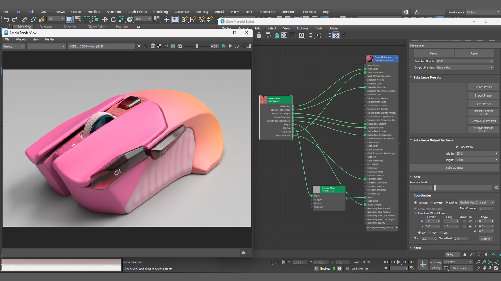

# 3ds Max 中的 Substance 概覽

## 外掛程式概覽

## 開啟物質

1. 開啟 Slate 編輯器，搜尋 Substance，並將 Substance2 節點拖曳到檢視中。
1. 雙擊 Substance 節點以啟用屬性，並在 Substance 套件瀏覽器下載入 Substance。

   >[!NOTE]
   >
   > 您也可以將 .sbsar 檔案拖放到 Slate 編輯器中，自動建立節點並匯入 sbar。

1. 如果一個實體包含多個圖表，您可以在「已選圖表」下拉選單中選擇想要輸出為材質的圖表。

   

1. 選取 Substance 節點後，前往 Substance 選單並選擇支援的渲染器。 材料會被製作完成，並準備好應用於物件上。 Substance 貼圖會直接連接到渲染材質中。

>[!NOTE]
>
> 選取「Substance2」節點後&#x200B;**，您需要先**&#x200B;點擊「載入物質...**」以選擇 sbsar 檔案，然後從頂方選單選擇支援的渲染器（例如「Substance to Arnold**」）。
>
>支援的渲染器包括 Arnold、V-Ray、Corona 和 Octane。 [了解 3DS Max 中的工作流程，了解如何使用 OpenPBR 材質。](../using-workflows-3ds-max/using-workflows-in-3ds-max.md)

## 變更解析度

1. 在「物質輸出設定」中設定計算出的 Substance 貼圖所需的解析度。
1. 若要支援最高 8K 解析度，請確認你使用的是 GPU 引擎，這在 Substance 設定[&#128279;](../../../3d-applications/3ds-max/settings-1/substance-settings.md)中設定。

   

## 變更參數

1. 雙擊 Substance 節點，以在參數視窗中載入 Substance 參數。
1. 更改參數以自動更新 Substance 貼圖。

   {width="500px"}

## 設定輸出預覽

你可以為 Substance 節點的縮圖設定特定通道。

1. 在「輸出預覽」下拉選單中，選擇您想用作節點縮圖的通道。

   

## 瓷磚材料

你可以使用 Coordinates 屬性來平鋪 Substance 貼圖並設定 Map Channels。

## OpenPBR 工作流程

在 Substance 選單&#x200B;**&#x200B;**&#x200B;的&#x200B;**工作流程**&#x200B;清單中，有兩種 OpenPBR 工作流程：**Substance 到 OpenPBR** 和 **Substance 到 V-Ray OpenPBR**。這些工作流程專為使用 Substance 3D Designer 或 Sampler 中 OpenPBR 材質模型撰寫的 SBSAR 檔案而設計（OpenPBR 自 Designer V16.0+ 與 Sampler V6.0+ 起即為預設模型）。

### 什麼是 OpenPBR？

OpenPBR 是一個由 Adobe 與 Autodesk 開發的開放、物理基礎材質著色模型，並對 Academy Software Foundation（ASWF）有所貢獻。 它提供統一的材質定義，且可在不同渲染器間相容。 欲了解更多資訊，請參閱 [OpenPBR 文件](https://experienceleague.adobe.com/en/docs/substance-3d/general-knowledge/openpbr/openpbr-overview)。

### 何時使用 OpenPBR 工作流程

當您的 SBSAR 檔案是使用 Substance 3D Designer 或 Substance 3D Sampler 中 OpenPBR 材質模型製作時，請使用 OpenPBR 工作流程。 如果您的 SBSAR 是使用 Adobe 標準材質模型（ASM）製作的，請使用與您的渲染器相容的舊有工作流程（Arnold、V-Ray 或 V-Ray 6）。

>[!NOTE]
>
> 如果您對 ASM 材料套用 OpenPBR 工作流程，或對 OpenPBR SBSAR 套用標準工作流程，外掛程式只會連接兩個材質模型共有的輸出。 結果可能不完整。

### 可用的 OpenPBR 工作流程

**OpenPBR**

使用原生的 3ds Max openPBRSurface 節點。 與 Arnold 和 V-Ray 相容。 這是大多數在 3ds Max 中使用 OpenPBR 材質的使用者所建議的工作流程。

**OpenPBR - V-Ray**

在 OpenPBR 模式下使用 V-Ray 材質（VRayMtl）。 建議專為以 V-Ray 材質設定為核心的管線使用者使用。

### 如何套用 OpenPBR 工作流程

1. 使用「載入物質」按鈕選擇您的 SBSAR 檔案（OpenPBR）。
1. 在頂端選單中，選擇 OpenPBR 或 OpenPBR - V-Ray。
1. 點選「建立網路」以在 Slate 材質編輯器中建立著色器網路。
1. 外掛程式會自動將 SBSAR 輸出連接到 OpenPBR 節點的對應輸入端。
1. 像平常一樣將材質指派到你的網格上。

