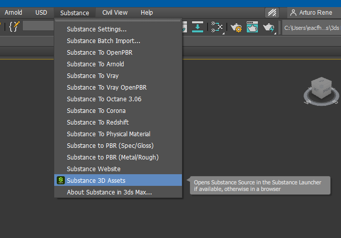

# Substance 3D 資產庫

你可以直接從 Substance for 3ds Max 外掛開啟 Substance 3D 資產函式庫。

1. 在 3ds Max 介面頂端的 Substance 選單中，選擇 Substance 3D 資產。
1. 瀏覽器會開啟，您可以登入 Adobe 帳戶下載 .sbsar 檔案。 Substance 訂閱者可無限存取完整 3D 資產庫。
1. 使用 Substance for 3ds Max 外掛下載並匯入 SBSAR 檔案到 3ds Max。

