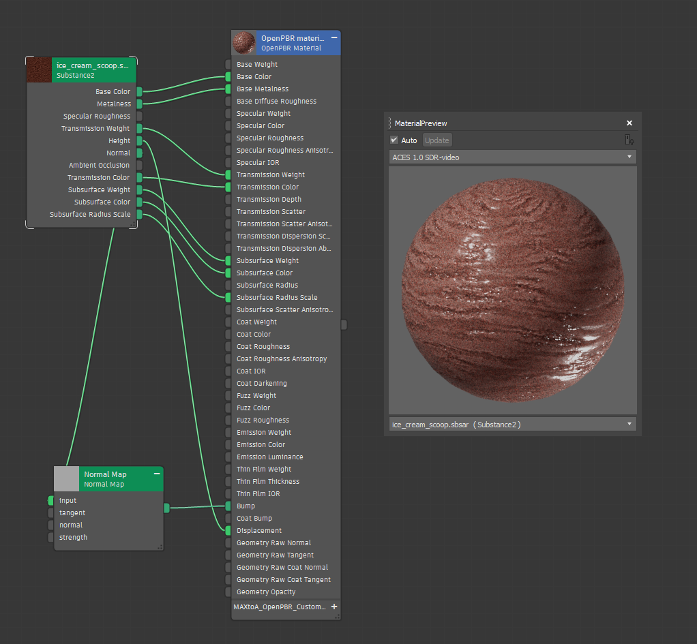

# 在 3ds Max 中使用工作流程

3ds Max 中的 Substance 外掛包含自動建立著色器網路以支援渲染器的工作流程。 渲染工作流程可在 Substance 選單中找到。

若要使用工作流程，請在材質編輯器中選取 Substance 節點，然後從 Substance 選單中選擇該工作流程。

## OpenPBR 工作流程

在 Substance 選單&#x200B;****&#x200B;的&#x200B;**工作流程**&#x200B;清單中，有兩種 OpenPBR 工作流程：**Substance 到 OpenPBR** 和 **Substance 到 V-Ray OpenPBR**。這些工作流程專為使用 Substance 3D Designer 或 Sampler 中 OpenPBR 材質模型撰寫的 SBSAR 檔案而設計（OpenPBR 自 Designer V16.0+ 與 Sampler V6.0+ 起即為預設模型）。

### 什麼是 OpenPBR？

OpenPBR 是一個由 Adobe 與 Autodesk 開發的開放、物理基礎材質著色模型，並對 Academy Software Foundation（ASWF）有所貢獻。 它提供統一的材質定義，且可在不同渲染器間相容。 欲了解更多資訊，請參閱 [OpenPBR 文件](https://experienceleague.adobe.com/en/docs/substance-3d/general-knowledge/openpbr/openpbr-overview)。

### 何時使用 OpenPBR 工作流程

當您的 SBSAR 檔案是使用 Substance 3D Designer 或 Substance 3D Sampler 中 OpenPBR 材質模型製作時，請使用 OpenPBR 工作流程。 如果您的 SBSAR 是使用 Adobe 標準材質模型（ASM）製作的，請使用與您的渲染器相容的舊有工作流程（Arnold、V-Ray 或 V-Ray 6）。

>[!NOTE]
>
> 如果您對 ASM 材料套用 OpenPBR 工作流程，或對 OpenPBR SBSAR 套用標準工作流程，外掛程式只會連接兩個材質模型共有的輸出。 結果可能不完整。

### 可用的 OpenPBR 工作流程

**OpenPBR**

使用原生的 3ds Max openPBRSurface 節點。 與 Arnold 和 V-Ray 相容。 這是大多數在 3ds Max 中使用 OpenPBR 材質的使用者所建議的工作流程。

**OpenPBR - V-Ray**

在 OpenPBR 模式下使用 V-Ray 材質（VRayMtl）。 建議專為以 V-Ray 材質設定為核心的管線使用者使用。

### 如何套用 OpenPBR 工作流程

1. 使用「載入物質」按鈕選擇您的 SBSAR 檔案（OpenPBR）。
1. 在頂端選單中，選擇 OpenPBR 或 OpenPBR - V-Ray。
1. 點選「建立網路」以在 Slate 材質編輯器中建立著色器網路。
1. 外掛程式會自動將 SBSAR 輸出連接到 OpenPBR 節點的對應輸入端。
1. 像平常一樣將材質指派到你的網格上。

